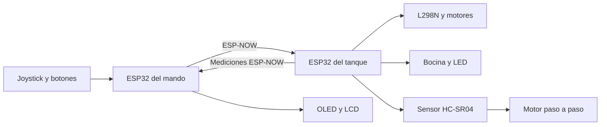

# Tanque a control remoto mediante ESP-NOW

Trabajo práctico final de **Laboratorio de Computación I**.

El proyecto consiste en una maqueta de tanque sobre ruedas, con estructura impresa en 3D y una torreta móvil prevista para una etapa posterior. Se controla mediante un mando propio compuesto por un joystick analógico y botones para manejar los movimientos y las funciones del tanque.

Dos placas ESP32 se comunican mediante **ESP-NOW**, utilizando la radio Wi-Fi integrada. La comunicación se realiza directamente entre los dispositivos, sin necesidad de un router ni de acceso a Internet.

## Estado actual del proyecto

El repositorio contiene el firmware del mando y del tanque, desarrollado de manera progresiva.

| Función | Estado |
|---|---|
| Lectura de los dos ejes del joystick | Implementada, con zona muerta y control proporcional |
| Control diferencial de dos motores mediante L298N | Implementado |
| Comunicación ESP-NOW | Implementada, en el canal 1 |
| Bocina | Implementada |
| Disparo mediante LED | Implementado |
| Recarga y gestión de munición | Implementadas parcialmente |
| Pantalla LCD 16×2 | Integrada en el mando |
| Pantalla OLED SSD1306 | Integrada para visualizar el radar |
| Sensor ultrasónico HC-SR04 | Integrado en el tanque |
| Motor paso a paso 28BYJ-48 | Integrado para mover el sensor del radar |
| Envío de mediciones del radar por ESP-NOW | Implementado |
| Visualización de mediciones en el OLED | Implementada |
| Diagnóstico por Monitor Serie | Implementado parcialmente; se amplía en V7 |
| Torreta móvil | Pendiente de integrar |
| Display de siete segmentos | Pendiente de integrar |
| Faros y sensor de iluminación | Pendientes de integrar |

El desarrollo se encuentra en etapa de integración y pruebas. La compilación y el funcionamiento de cada parte deben verificarse con el montaje físico definitivo. Las pruebas de simulación no reemplazan la validación eléctrica y mecánica del tanque.

## Equipo

- **Integrantes:** Joaquin Ayerra, Thiago Lartigau, Mauro Rodriguez y Juan Ignacio Ferrando Villoslada.
- **Docentes:** Pedro Iriso y Matías Gagliardo.

## Controles y conexiones del mando

El mando utiliza un ESP32 clásico, un joystick analógico de dos ejes y botones conectados entre sus respectivos GPIO y GND. Las entradas de los pulsadores utilizan `INPUT_PULLUP`, por lo que su lectura es `HIGH` cuando están liberados y `LOW` cuando están presionados.

| Control | Pin del ESP32 | Función |
|---|---|---|
| Eje horizontal del joystick (VRX) | GPIO32 | Regula el giro |
| Eje vertical del joystick (VRY) | GPIO33 | Regula el avance y retroceso |
| Botón de disparo | GPIO27 | Solicita un disparo |
| Botón de recarga | GPIO14 | Solicita una recarga |
| Botón de bocina | GPIO26 | Activa la bocina mientras se mantiene presionado |
| Botón de radar | GPIO25 | Activa o pausa la visualización del radar |

El joystick se alimenta con 3,3 V. Los centros de los ejes se encuentran configurados aproximadamente en 1888 unidades, con una zona muerta de 100 unidades hacia cada lado. Estos valores pueden necesitar calibración según el joystick utilizado.

El mando también incorpora dos pantallas mediante comunicación I2C:

- LCD de 16×2, dirección `0x27`.
- OLED SSD1306 de 128×64 píxeles, dirección `0x3C`.

Ambas utilizan SDA en GPIO21 y SCL en GPIO22.

## Componentes

| Parte | Componentes utilizados |
|---|---|
| Mando | ESP32 clásico, joystick analógico de dos ejes, botones, LCD 16×2 y OLED SSD1306 |
| Tanque | ESP32 clásico, controlador L298N, dos motores de corriente continua, bocina, LED de disparo, sensor HC-SR04 y motor paso a paso 28BYJ-48 con controlador ULN2003 |

Para completar la maqueta se prevén una estructura impresa en 3D, una torreta móvil, faros, un sensor de iluminación y un display de siete segmentos.

La alimentación de los motores y actuadores debe dimensionarse según su consumo. Los motores no deben alimentarse directamente desde los GPIO del ESP32.

## Conexiones del tanque

### Motores y actuadores

| Componente o entrada del L298N | Pin del ESP32 |
|---|---|
| ENA, velocidad del motor izquierdo | GPIO18 |
| IN1, sentido del motor izquierdo | GPIO19 |
| IN2, sentido del motor izquierdo | GPIO21 |
| ENB, velocidad del motor derecho | GPIO5 |
| IN3, sentido del motor derecho | GPIO22 |
| IN4, sentido del motor derecho | GPIO23 |
| Bocina | GPIO25 |
| LED de disparo | GPIO26 |

Los pines ENA y ENB se controlan mediante PWM. Para regular su velocidad desde el ESP32, deben retirarse los puentes de habilitación correspondientes del módulo L298N.

Las masas del ESP32, el controlador de motores y las fuentes externas deben estar conectadas en común.

### Sensor ultrasónico

| Conexión HC-SR04 | Pin del ESP32 |
|---|---|
| TRIG | GPIO32 |
| ECHO | GPIO34 |
| VCC | 5 V |
| GND | GND |

**Importante:** la salida ECHO del HC-SR04 puede entregar 5 V. Se debe utilizar un divisor resistivo para reducir esa tensión a un nivel seguro para el ESP32, cuya entrada trabaja a 3,3 V.

### Motor paso a paso

El motor 28BYJ-48 se conecta al controlador ULN2003.

| Entrada ULN2003 | Pin del ESP32 |
|---|---|
| IN1 | GPIO13 |
| IN2 | GPIO14 |
| IN3 | GPIO27 |
| IN4 | GPIO33 |

El motor se alimenta mediante una fuente externa de 5 V conectada al ULN2003. La fuente y el ESP32 deben compartir GND.

## Comunicación y lógica del firmware

La comunicación entre las placas se realiza mediante ESP-NOW, en el canal 1 y utilizando la dirección de difusión:

`FF:FF:FF:FF:FF:FF`

El esquema general de funcionamiento es el siguiente:



### Paquetes de datos

El firmware utiliza dos estructuras para intercambiar información.

El paquete de control contiene:

```cpp
struct Datos {
  int16_t motorIzquierdo;
  int16_t motorDerecho;
  uint8_t bocina;
  uint8_t disparo;
};
```

Esta estructura ocupa 6 bytes.

Para las mediciones del radar se utiliza:

```cpp
struct __attribute__((packed)) DatosRadar {
  uint8_t tipo;
  int16_t angulo;
  uint16_t distancia;
};
```

Esta estructura ocupa 5 bytes y permite identificar el paquete mediante el campo `tipo`.

La distancia se transmite en décimas de centímetro. Cuando no se obtiene una medición válida, se utiliza el valor `0xFFFF`.

Las estructuras correspondientes deben coincidir en ambos programas que participan de cada intercambio.

### Movimiento del tanque

El movimiento se realiza mediante un sistema de control diferencial.

```text
Motor izquierdo = avance + giro
Motor derecho   = avance - giro
```

Los valores resultantes se ajustan para mantenerse entre -255 y 255. El signo determina el sentido de giro y el valor absoluto representa la velocidad mediante PWM.

El firmware del tanque utiliza un tiempo de espera de 500 ms para detectar la pérdida de comunicación. Si no recibe un paquete de control válido dentro de ese período, detiene los motores y apaga la bocina y el LED de disparo.

### Radar y medición de distancia

El motor paso a paso mueve el sensor ultrasónico de un extremo al otro del recorrido. Mientras el motor permanece detenido durante una medición, el HC-SR04 obtiene la distancia al objeto detectado.

El tanque envía el ángulo y la distancia obtenida al mando mediante ESP-NOW.

El mando utiliza esos datos para representar las detecciones en la pantalla OLED mediante un gráfico de radar.

El ángulo enviado al sistema gráfico se representa entre 0° y 180°, equivalente a un recorrido visual de -90° a +90° respecto del centro.

### Ejecución sin bloqueos

Las tareas principales del firmware se organizan mediante `millis()` y `micros()`, utilizando temporizadores y máquinas de estados.

Se evita utilizar `delay()`, `delayMicroseconds()` y `pulseIn()` en la lógica de funcionamiento, para no bloquear la lectura de controles ni la comunicación entre las placas.

Los mensajes de diagnóstico se pueden consultar desde el Monitor Serie de Arduino IDE, configurado a 115200 baudios.

## Organización del repositorio

| Archivo | Contenido |
|---|---|
| `Control/Control.ino` | Firmware del mando |
| `Tanque/Tanque.ino` | Firmware del tanque |
| `control.c` | Implementación anterior del control, con otra distribución de botones y otro formato de mensaje |
| `CHANGELOG.md` | Historial de cambios del proyecto |

Los archivos actuales del mando y del tanque deben utilizar formatos de comunicación compatibles. No se deben combinar versiones antiguas de un programa con versiones nuevas del otro sin comprobar sus estructuras de datos y el canal de radio.

## Cómo cargar y probar

1. Instalar Arduino IDE.
2. Instalar el paquete de placas ESP32 de Espressif Systems.
3. Conectar el ESP32 del mando y seleccionar el puerto correspondiente.
4. Abrir `Control/Control.ino` y cargar el programa.
5. Conectar el ESP32 del tanque.
6. Abrir `Tanque/Tanque.ino` y cargar el programa.
7. Verificar que ambas placas estén configuradas para utilizar el mismo canal ESP-NOW.
8. Comprobar las conexiones, la alimentación y las masas comunes.
9. Abrir los monitores serie a 115200 baudios.
10. Probar los controles, los motores, la bocina, el disparo y el radar.

El código contempla diferencias entre versiones de Arduino-ESP32 2.x y 3.x para algunas funciones de ESP-NOW y PWM. La compatibilidad definitiva debe comprobarse durante la compilación y carga en las placas utilizadas.

Para las pruebas de simulación, ambos ESP32 deben estar incluidos en el mismo circuito y la plataforma debe admitir la comunicación inalámbrica simulada. Las pruebas físicas siguen siendo necesarias para validar motores, alimentación, sensores y alcance de comunicación.

## Funciones previstas para completar el proyecto

- Mostrar la munición restante en un display LCD I2C 16x2.
- Descontar una unidad por cada disparo válido.
- Bloquear el disparo cuando el cargador esté vacío o durante una recarga.
- Implementar la recarga de 30 segundos y restablecer la munición a nueve unidades al completarla.
- Definir los modos de funcionamiento del mando.
- Integrar el movimiento de la torreta.
- Incorporar un sensor frontal para detectar obstáculos y bloquear el avance cuando corresponda, permitiendo el retroceso.
- Integrar el control automático de faros mediante un sensor de iluminación.
- Definir el control manual de los faros y su período de funcionamiento.
- Confirmar con la cátedra la equivalencia de PWM para el requisito de salida analógica.
- Validar todos los movimientos y la parada por pérdida de comunicación.
- Completar el montaje eléctrico y mecánico.
- Incorporar el esquema eléctrico definitivo, el informe, las fotografías y el video de demostración.

## Licencia y créditos

La licencia del proyecto queda pendiente de definir por el grupo.

Los créditos de bibliotecas, modelos 3D y otros recursos de terceros se agregarán cuando se confirme cuáles se utilizan.