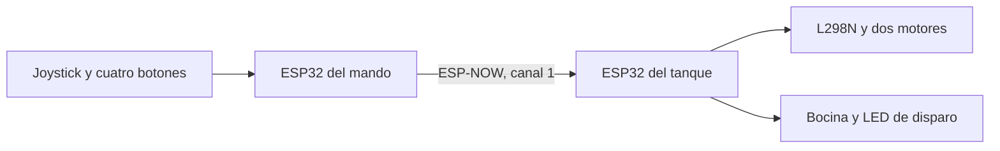

# Tanque a control remoto por Wi-Fi

Trabajo práctico final de **Laboratorio de Computación I**.

El proyecto consiste en una maqueta de tanque sobre ruedas, con estructura impresa en 3D y torreta móvil prevista para una etapa posterior. Se controla desde un mando propio con un joystick analógico, cuatro botones y el pulsador incorporado en el joystick.

Dos ESP32 intercambian los controles mediante **ESP-NOW**, utilizando la radio Wi-Fi de las placas. La implementación actual funciona directamente entre los dispositivos, sin router ni acceso a Internet.

## Estado actual

La rama `dev` contiene una primera versión del firmware del mando y una versión básica del tanque.

| Función | Estado |
| --- | --- |
| Lectura de los dos ejes del joystick | Implementada, con zona muerta y velocidad proporcional |
| Cuatro botones y clic del joystick | Implementados, con antirrebote y detección de nuevas pulsaciones |
| Comunicación ESP-NOW | Implementada, en el canal 1 |
| Control diferencial de dos motores mediante L298N | Implementado, pendiente de validación completa de movimientos |
| Bocina | Implementada mientras se mantiene apretado su botón |
| Disparo | Implementado como un pulso de 150 ms en un LED |
| Recarga, auxiliar y cambio de modo | Eventos transmitidos y reconocidos por el tanque, con acciones finales pendientes |
| Parada al dejar de recibir datos durante 500 ms | Implementada, pendiente de prueba específica de pérdida de comunicación |
| Display de siete segmentos y contador de balas | Pendientes de integrar |
| Torreta, sensores y faros | Pendientes de integrar |

Se comprobó en Mokxi la compilación y ejecución de ambos programas, la recepción de controles, las pulsaciones y la activación y liberación de la bocina. El recorrido completo de los motores, la pérdida intencional de paquetes y el montaje físico siguen pendientes de validar.

## Equipo

- **Integrantes** Joaquin Ayerra, Thiago Lartigau, Mauro Rodriguez y Juan Ignacio Ferrando Villoslada.
- **Docentes** Pedro Iriso y Matías Gagliardo.

## Controles y conexiones del mando

El joystick recibe alimentación de **3,3 V**. Todos los pulsadores se conectan entre su GPIO y GND y se leen con `INPUT_PULLUP`. Al apretarlos, la entrada pasa de `HIGH` a `LOW`.

| Control | Pin del ESP32 | Comportamiento actual |
| --- | --- | --- |
| Eje horizontal del joystick, VRX | GPIO32 | Regula el giro |
| Eje vertical del joystick, VRY | GPIO33 | Regula el avance y el retroceso |
| Botón de disparo | GPIO27 | Registra una pulsación y solicita un disparo |
| Botón de recarga | GPIO18 | Solicita recarga, cuya lógica está pendiente |
| Botón de bocina | GPIO19 | Mantiene activa la bocina mientras se presiona |
| Botón auxiliar | GPIO21 | Comunica una pulsación con función final pendiente |
| Clic del joystick, SW | GPIO26 | Solicita un cambio de modo, cuya lógica está pendiente |

Hay cinco entradas de pulsadores en el código porque se cuentan los **cuatro botones físicos y el clic del joystick**.

Los centros de ambos ejes están configurados en `1888`, con una zona muerta de `100` unidades hacia cada lado. Estos valores deben calibrarse para el joystick físico. `INVERTIR_EJE_X` e `INVERTIR_EJE_Y` permiten invertir el sentido de cada eje.

## Componentes

| Parte | Componentes utilizados en la simulación actual |
| --- | --- |
| Mando | Un ESP32 clásico, un joystick analógico de dos ejes con pulsador y cuatro botones |
| Tanque | Un ESP32 clásico, un L298N, dos motores de corriente continua, una bocina y un LED de disparo con resistencia |

Para completar la maqueta se prevén el chasis impreso en 3D, la torreta con servo, un sensor frontal de proximidad, un sensor de iluminación, faros y un display de siete segmentos de un dígito.

La alimentación definitiva y los modelos de los componentes físicos deben confirmarse con el montaje. Los motores requieren una alimentación dimensionada para su consumo y conectada al controlador de motores.

## Conexiones del tanque

| Componente o entrada del L298N | Pin del ESP32 |
| --- | --- |
| Bocina | GPIO25 |
| LED de disparo | GPIO26 |
| ENA, velocidad del motor izquierdo | GPIO18 |
| IN1, sentido del motor izquierdo | GPIO19 |
| IN2, sentido del motor izquierdo | GPIO21 |
| ENB, velocidad del motor derecho | GPIO5 |
| IN3, sentido del motor derecho | GPIO22 |
| IN4, sentido del motor derecho | GPIO23 |

ENA y ENB se controlan mediante PWM a 1000 Hz y resolución de 8 bits. En el módulo L298N, los puentes de habilitación de ENA y ENB deben retirarse para controlar esas entradas desde el ESP32. Las masas de la placa, el controlador y su alimentación deben estar unidas.

## Comunicación y lógica del firmware



El mando intenta transmitir cada **20 ms**, siempre que haya finalizado el envío anterior. Utiliza la dirección de difusión `FF:FF:FF:FF:FF:FF`. Ambos dispositivos deben compartir el mismo canal.

Cada paquete contiene las velocidades de ambos motores, los estados de los pulsadores, los contadores de disparo, recarga, auxiliar y cambio de modo, y un identificador de arranque del mando. La estructura `DatosDelMando` ocupa 32 bytes y debe ser idéntica en ambos programas.

El antirrebote confirma un estado después de **30 ms** sin cambios. El paso confirmado de `HIGH` a `LOW` registra una nueva pulsación. Los contadores se repiten en cada paquete para que un paquete aislado perdido no borre el evento y los paquetes repetidos no vuelvan a ejecutar la misma acción.

El tanque toma los contadores del primer paquete como referencia al establecer comunicación o detectar un nuevo arranque del mando. Los cambios posteriores generan eventos. Si se acumulan varias pulsaciones entre dos paquetes recibidos, la implementación actual genera una indicación por cambio de contador. La gestión individual de eventos acumulados queda pendiente para el contador de munición.

La mezcla diferencial se calcula de esta forma.

```text
Motor izquierdo = avance + giro
Motor derecho   = avance - giro
```

Los resultados se ajustan proporcionalmente para mantenerse entre -255 y 255. El signo define el sentido y el valor absoluto define el PWM.

Si el tanque permanece **500 ms sin recibir un paquete válido**, ordena velocidad cero y apaga la bocina y el LED de disparo.

Los tiempos se manejan con `millis()`. Ambos programas evitan `delay()` y `sleep()`. La información de diagnóstico se muestra por el **Serial Monitor de la computadora** a 115200 baudios. No se agrega una pantalla física para esos mensajes.

## Organización del repositorio

| Archivo | Contenido |
| --- | --- |
| [Control/Control.ino](Control/Control.ino) | Firmware actual del mando |
| [Tanque/Tanque.ino](Tanque/Tanque.ino) | Firmware actual del tanque |
| [control.c](control.c) | Implementación anterior del control, con otra distribución de botones y otro formato de mensaje |
| [CHANGELOG.md](CHANGELOG.md) | Historial de cambios del proyecto |

Para utilizar esta integración se deben cargar juntos `Control/Control.ino` y `Tanque/Tanque.ino`, que comparten el mismo formato de paquete.

## Cómo cargar y probar

1. Instalar Arduino IDE y el paquete de placas **esp32 de Espressif Systems**.
2. Abrir `Control/Control.ino`, seleccionar la placa ESP32 correspondiente y cargarlo en el mando.
3. Abrir `Tanque/Tanque.ino` y cargarlo en el ESP32 del tanque.
4. Verificar las conexiones, la alimentación y que ambos programas tengan el mismo `CANAL_RADIO`.
5. Encender las dos placas y abrir sus monitores serie a 115200 baudios para observar el intercambio.
6. Probar el joystick, los cuatro botones y el clic del joystick.

El código contempla las diferencias de PWM de Arduino-ESP32 2 y 3 y las firmas de las funciones de ESP-NOW. La compatibilidad con cada versión y con las placas físicas debe comprobarse durante la carga.

En Mokxi, ambos ESP32 deben estar en el mismo circuito para que la radio simulada intercambie mensajes. Los enlaces siguientes corresponden a los proyectos de referencia usados para la integración.

- [Tanque con dos motores y L298N](https://mokxi.com/p/sjBymzgRi698FahR)
- [Mando con joystick y cuatro botones](https://mokxi.com/p/y2b2WzW2gkDH8BE6)

## Funciones previstas para completar el proyecto

- Mostrar la munición restante de 0 a 9 en el display de siete segmentos.
- Descontar una unidad por disparo válido y bloquear el disparo con el cargador vacío o durante la recarga.
- Implementar la recarga de 30 segundos y restablecer la munición a nueve al completarla.
- Definir los modos seleccionados con el clic del joystick e integrar el movimiento de la torreta.
- Integrar el sensor frontal para bloquear el avance ante obstáculos y permitir el retroceso.
- Integrar el control automático de faros por luz ambiente y el período manual previsto de 120 segundos. La asignación de ese control al botón auxiliar queda pendiente.
- Confirmar con la cátedra la equivalencia de PWM para el requisito de salida analógica.
- Validar todos los movimientos, la parada por pérdida de comunicación y el funcionamiento eléctrico de la maqueta.
- Incorporar el esquema eléctrico definitivo, el informe, las fotos y el video de demostración.

## Licencia y créditos

Licencia pendiente de definir por el grupo. Los créditos de bibliotecas, modelos 3D y otros recursos de terceros se agregarán cuando se confirme cuáles se utilizan.
