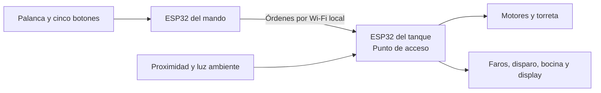

# Tanque a control remoto por Wi-Fi

Trabajo práctico final de **Laboratorio de Computación I**.

El proyecto consiste en una maqueta de tanque sobre ruedas, con estructura impresa en 3D y torreta móvil. Se controla desde un mando propio con una palanca analógica y cinco botones. Una ESP32 en el tanque crea la red Wi-Fi y otra en el mando se conecta directamente para enviar las órdenes. El sistema funciona en una red local sin router ni acceso a Internet.

**Estado del repositorio.** Este README describe el diseño previsto. El código, los esquemas eléctricos y la demostración se incorporarán a medida que estén disponibles.

## Equipo

- **Grupo e integrantes:** a completar con número de grupo, nombres, apellidos y correos.
- **Docentes:** Pedro Iriso y Matías Gagliardo.

## Controles

| Control | Función |
| --- | --- |
| Palanca analógica | Avanza, retrocede y gira. La inclinación regula la velocidad. |
| Botón de luces | Invierte el estado de los faros y activa el control manual durante dos minutos. Cada pulsación reinicia ese tiempo. |
| Botón de disparo | Emite un destello y descuenta una unidad de munición por pulsación válida. |
| Botón de recarga | Inicia una recarga de 30 segundos, incluso si queda munición. |
| Botón de torreta | Mientras se mantiene presionado, la palanca controla la torreta. |
| Botón de bocina | Activa la señal sonora. |

El sensor frontal bloquea el avance ante un obstáculo cercano y permite retroceder. Si el tanque deja de recibir órdenes válidas, detiene los motores. Los faros vuelven al control automático al vencer el período manual y se encienden cuando hay poca luz.

El display de siete segmentos muestra la munición restante, de 0 a 9. El disparo se bloquea con el cargador vacío o durante la recarga. Al completarse la recarga, el saldo vuelve a nueve.

## Componentes previstos

| Parte | Componente | Función |
| --- | --- | --- |
| Mando | 1 ESP32, 1 palanca analógica de dos ejes y 5 pulsadores | Leer controles físicos y enviar órdenes por Wi-Fi. |
| Tanque | 1 ESP32 | Crear la red, recibir órdenes, leer sensores y controlar salidas. |
| Tanque | Chasis impreso en 3D, ruedas, motores y controlador de motores | Sostener el montaje y mover la maqueta con velocidad variable. |
| Tanque | 1 servo | Mover la torreta. |
| Tanque | 1 sensor de proximidad y 1 sensor de iluminación | Detectar obstáculos al frente y medir la luz ambiente. |
| Tanque | Faros, LED de disparo, bocina y display de siete segmentos de un dígito | Iluminar, simular el disparo, emitir sonido y mostrar la munición. |
| Ambos | Alimentación y cableado | Distribuir energía y conectar las placas con sus entradas y salidas. |

La cantidad de ruedas y motores, los modelos de los módulos y la alimentación se confirmarán con el montaje. El inventario y el estado de cada elección se detallan en [PROJECT_CONTEXT.md](PROJECT_CONTEXT.md).

## Esquema funcional

El esquema eléctrico con conexiones y pines se incorporará en `doc/` cuando se definan los componentes.

## Lógica del firmware

El firmware se plantea para el entorno Arduino. El mando lee los ejes analógicos y los botones digitales. El tanque usa las lecturas de sus sensores para decidir cuándo bloquear el avance y cuándo encender los faros. Las salidas incluyen el LED de disparo, la bocina y el display. El control proporcional de los motores se prevé mediante PWM. La equivalencia de PWM para el requisito de salida analógica queda por confirmar con la cátedra.

El **contador de flancos** se implementa sobre el botón físico de disparo en el mando. El antirrebote permite contar una transición por pulsación. El tanque descuenta munición sólo si acepta el evento y debe reconocer los mensajes repetidos para evitar disparos duplicados.

Los **temporizadores** se implementarán con `millis()` o un mecanismo equivalente. La recarga, el destello, el control manual de faros y la supervisión del enlace avanzan sin bloquear la lectura de controles ni el procesamiento de mensajes.

| Máquina de estados | Transiciones previstas |
| --- | --- |
| Enlace | Pasa a sin conexión al vencer el tiempo sin órdenes válidas y detiene los motores. |
| Palanca | Controla la conducción por defecto y pasa al control de torreta mientras se mantiene presionado su botón. |
| Munición | Pasa de disponible a vacío al llegar a cero. El botón inicia la recarga y, al cabo de 30 segundos, restablece el cargador a nueve. |
| Faros | Pasa de automático a manual con el botón. Vuelve a automático tras 120 segundos desde la última pulsación. |

## Uso previsto

1. Cargar en cada ESP32 el firmware correspondiente al mando o al tanque.
2. Encender el tanque para que cree su red Wi-Fi.
3. Encender el mando y esperar a que se conecte a esa red.
4. Usar la palanca y los botones según la tabla de controles.

La configuración del entorno, las instrucciones exactas de carga y el esquema de montaje se agregarán junto con el firmware.

## Organización prevista del repositorio

| Carpeta | Contenido |
| --- | --- |
| `src/` | Firmware del mando y del tanque. |
| `doc/` | Informe, esquema eléctrico y diagramas. |
| `media/` | Fotos y video de demostración. |

## Demostración

La prueba incluirá conducción y torreta, bloqueo ante un obstáculo, detención al perder la señal, luces automáticas y manuales, y el ciclo completo de disparo y recarga. Las fotos y el video se agregarán después de probar la maqueta.

## Licencia y créditos

Licencia a definir por el grupo. Los créditos de bibliotecas, modelos 3D y otros recursos de terceros se agregarán cuando se confirme cuáles se usan.
